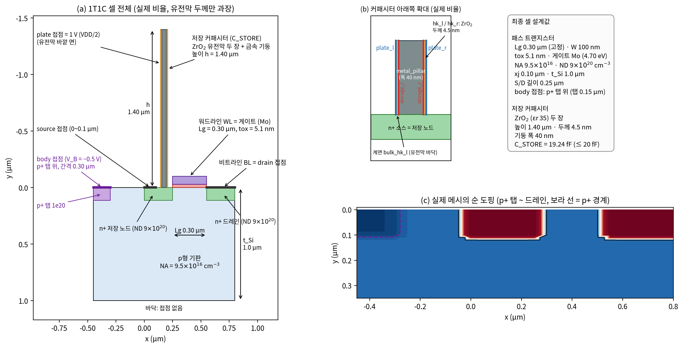
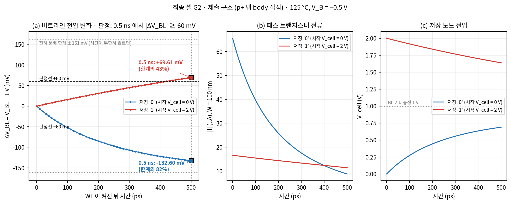
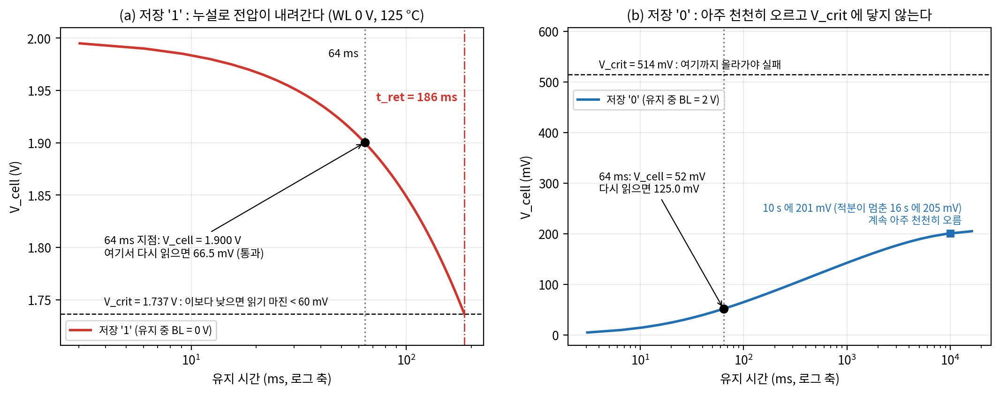
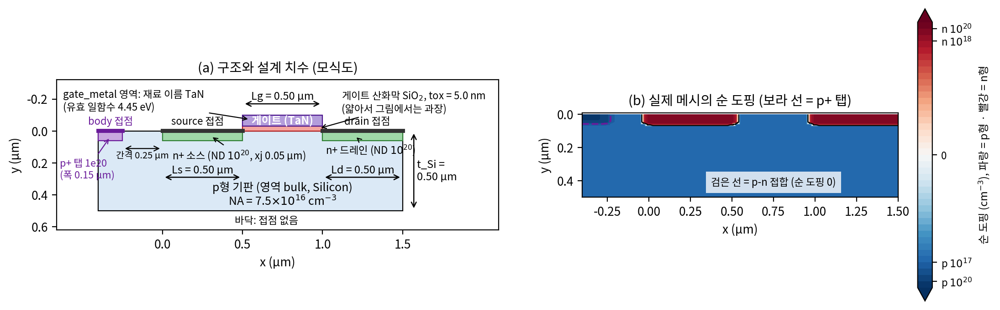
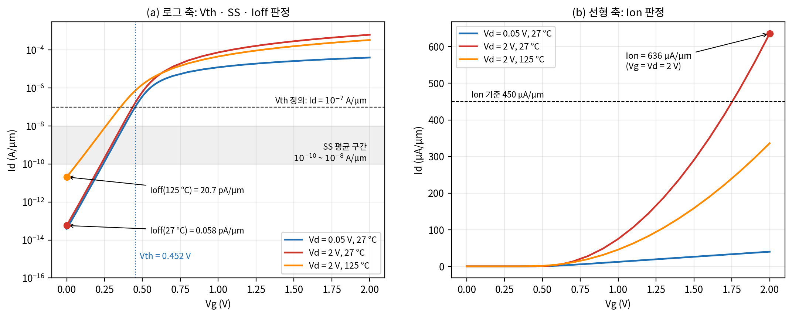

# DEVSIM 1T1C DRAM Memory Cell & nMOSFET

[DEVSIM](https://devsim.org) 2.10(2-D drift-diffusion TCAD)으로 만든 MOSFET 시뮬레이터와 및 설계한 **스펙 nMOSFET**과 **DRAM 1T1C 메모리 셀**.


| 폴더                      | 내용                                                                         |
| ----------------------- | -------------------------------------------------------------------------- |
| `[step1/](step1)`       | HW#1 1단계: square-law 간이 MOSFET 클래스                                         |
| `[step2/](step2)`       | HW#1 2단계: DEVSIM MOSFET 시뮬레이터(`mosfet_tool`), Id-Vg / Id-Vd / C-V, TCAD 비교 |
| `[step3/](step3)`       | HW#1 3단계: Streamlit GUI로 두 소자 비교                                           |
| `[project1/](project1)` | Project #1: Part 1 nMOSFET, Part 2 1T1C 셀, 결과(CSV·JSON·그림)                 |


## Part 2 — DRAM 1T1C 셀

패스 트랜지스터(Lg 0.30 µm, Mo 게이트, tox 5.1 nm)와 ZrO₂ 기둥형 커패시터(높이 1.40 µm, 두께 4.5 nm)를 한 구조에 넣었음. body 접점은 소스 왼쪽의 p+ 탭 위에 존재.



0.5 ns 과도 읽기와 125 °C 리텐션(Δt 스텝 준정적 계산, 셀이 V_crit 에 닿는 시각 = t_ret):





| 항목                    | 기준              | 결과                |
| --------------------- | --------------- | ----------------- |
| C_STORE (plate dQ/dV) | ≤ 20 fF         | 19.24 fF          |
| 읽기 '0' / '1' (0.5 ns) | ≥ 60 mV         | 132.6 / 69.6 mV   |
| 64 ms 뒤 읽기 '0' / '1'  | ≥ 60 mV         | 125.0 / 66.5 mV   |
| t_ret '1' (125 °C)    | ≥ 64 ms         | 185.6 ms          |
| t_ret '0' (125 °C)    | ≥ 64 ms         | V_crit 미도달        |
| E_ox / E_diel         | ≤ 5 / ≤ 4 MV/cm | 4.90 / 2.22 MV/cm |


## Part 1 — 스펙 nMOSFET

Lg 0.50 µm, TaN 게이트, tox 5.0 nm, NA 7.5×10¹⁶ cm⁻³, xj 0.05 µm. 해당 과정에서 시뮬레이터에 게이트 일함수, n_i·Eg 의 온도 의존(Varshni), 이동도의 온도 의존성 등 물리 현상에 대해 고려함.





| 항목                      | 기준                | 결과                 |
| ----------------------- | ----------------- | ------------------ |
| Vth (Id = 1e-7 A/µm)    | 0.45 ± 0.05 V     | 0.452 V            |
| Ion                     | ≥ 450 µA/µm       | 635.8 µA/µm        |
| Ioff 27 °C / 125 °C     | ≤ 1 / ≤ 100 pA/µm | 0.058 / 20.7 pA/µm |
| SS                      | ≤ 75 mV/dec       | 69.4 mV/dec        |
| DIBL                    | ≤ 30 mV/V         | 8.3 mV/V           |
| Body effect (Vb −0.5 V) | ≤ 80 mV           | 54.2 mV            |
| E_ox                    | ≤ 5 MV/cm         | 4.0 MV/cm          |


## 실행

Python 3.11 + `devsim==2.10.0` 환경이 필요(`[environment.yml](environment.yml)`). Windows에서는 각 폴더의 `.bat` 를 더블클릭(같은 폴더의 `.conda\` 를 찾음). conda 환경에서는 아래와 같이 실행.

```bash
conda env create -f environment.yml && conda activate devsim-project
cd project1
python -m part1.body_tap      # Part 1 8항목 (약 6분)
python -m part2.body_tap      # Part 2 읽기·리텐션 (약 50분)
```

- 실행 안내와 bat 목록: `[project1/README.md](project1/README.md)`
- 결과: `[project1/results/](project1/results)` (CSV·JSON·plotly HTML, 제출 구조는 `results/bodytap/`)
- 그림: `[project1/report/fig/](project1/report/fig)` (`report/tools/make_figures2.py` 활용하여 그림)
- 소자 파일: `[project1/part1_2021144048.devsim](project1/part1_2021144048.devsim)`, `[project1/part2_2021144048.devsim](project1/part2_2021144048.devsim)`

